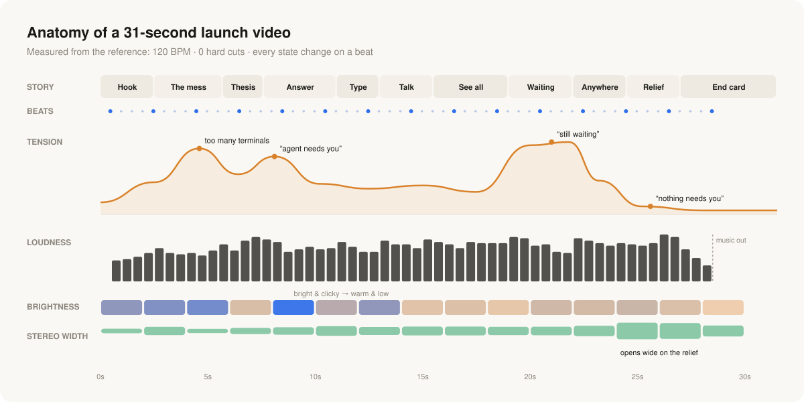

<div align="center">

# Product Demo Launch Video

**A Claude Code skill for planning launch videos people can't stop watching.<br/>It's built from a frame-by-frame, beat-by-beat teardown of one that went viral.**

```bash
npx skills add seyonv/product-demo-launch-video
```

</div>

---



## Why this exists

Some launch videos get scrolled past. Others get watched three times and sent to a group chat. It isn't easy to say what the difference is. "It looks polished" doesn't tell you how to make one.

This skill came out of a launch video ([kyzo's "One", 31 seconds, 570k+ views](https://x.com/ky__zo/status/2107549434280284460)) that felt incredible for reasons I couldn't name. So I measured it: frames four times a second, scene-cut detection, spectral analysis of the audio, beat onsets and stereo width. What came out wasn't "good taste". It was a set of rules you can follow, and you can check whether a video follows them.

The whole skill comes down to one sentence:

> **One continuous camera, one beat grid, one sentence per feature, and the real UI doing the real thing at the speed of a keystroke.**

## What the measurements found

| | Finding | Rule it becomes |
|---|---|---|
| 🎥 | **Zero hard cuts** in 31s, even at a 5% scene threshold | Every transition is a camera move or a morph. If A can't flow into B, reorder. |
| 🥁 | **120 BPM**, and every state change lands on a beat | Pick the track first. Storyboard in beats, not seconds. |
| ⌨️ | Every action shows its **input**: big keycaps, voice waveforms | Never let the UI change without a visible cause. Respond within 1 beat. |
| ✍️ | Each feature is a **2–5 word verb sentence**: *Answer in a keystroke.* | Features are things the viewer *does*. No adjectives, no feature names. |
| 📈 | A hidden **tension → release** story about waiting | Find the one recurring pain. Each feature defuses it. End on its absence. |
| 🔊 | Sound goes **bright & clicky → warm & low → wide open** | Map timbre to emotion. Give every action its own soft micro-sound. |
| 🪨 | Each opening image is a **visual pun** on its brand (a rocket for Grok) | Every image needs a *why*. "It looks cool" isn't a reason. |
| 🔍 | About **one deliberate detail every 1–2 seconds** | Do a detail pass. The care *is* the message. |

The full reasoning for all twelve principles is in [`SKILL.md`](SKILL.md). The second-by-second teardown, with the audio table, is in [`reference-one.md`](reference-one.md).

## What the skill does

Ask Claude Code for a launch video and the skill walks it through the same process every time:

```
1. Gather      product, the one recurring pain, 3–5 features, platform, URL
2. Spine       pain → verb headlines → the absence of pain → ≤5-word promise
3. Track       110–128 BPM, length budgeted in beats (30s ≈ 60 beats)
4. Beat sheet  beat | camera | text | UI state | input shown | SFX | bridge
4b. Passes     meaning pass (every image justified) · detail pass · sound cue list
5. Review      you approve the beat sheet before anything is rendered
6. Produce     Remotion by default: crisp zooms, 3D tilts, frame-exact sound
7. Verify      contact sheet, muted watch, sound watch, 14-point checklist
```

It also works for **critiquing** an existing launch video or **studying** a new reference. It includes the exact `ffmpeg` and numpy commands for measuring cuts, beats and audio, so the next teardown starts from data rather than vibes.

## Install

```bash
npx skills add seyonv/product-demo-launch-video
```

Or by hand:

```bash
git clone https://github.com/seyonv/product-demo-launch-video ~/.claude/skills/product-demo-launch-video
```

Then ask: *"Make a launch video for my app"*, *"storyboard a 30s demo for X"*, or *"why is this launch video so good?"*

## The checklist

A video ships when all fourteen pass:

- [ ] Zero hard cuts, except at most one world-change, dissolved through a shared shape
- [ ] Every state change on a beat or half-beat; SFX fill the subdivisions
- [ ] Every UI change has a visible input
- [ ] Every headline is ≤5 words and verb-led
- [ ] No product before ~3s; recognizable context first
- [ ] One recurring tension, resolved, ending on a calm or empty state
- [ ] One accent color; status colors only mean status
- [ ] All fake data is specific and plausible
- [ ] End card: logo + ≤5-word promise + URL, held ~3s, audio tails off
- [ ] The story still reads when muted; 20–40s total
- [ ] Every image has a stated meaning
- [ ] Every visible action has its own soft micro-sound
- [ ] Audio timbre follows the arc: bright, then warm, then wide, then fade
- [ ] Detail pass done: about one rewarding touch every 1–2s

## Credit

All the analysis here is of [the "One" launch video by kyzo](https://x.com/ky__zo/status/2107549434280284460). Go watch it with headphones on. This repo has no frames or audio from it, only measurements and commentary. The diagram above is drawn from those measurements.

## License

MIT
